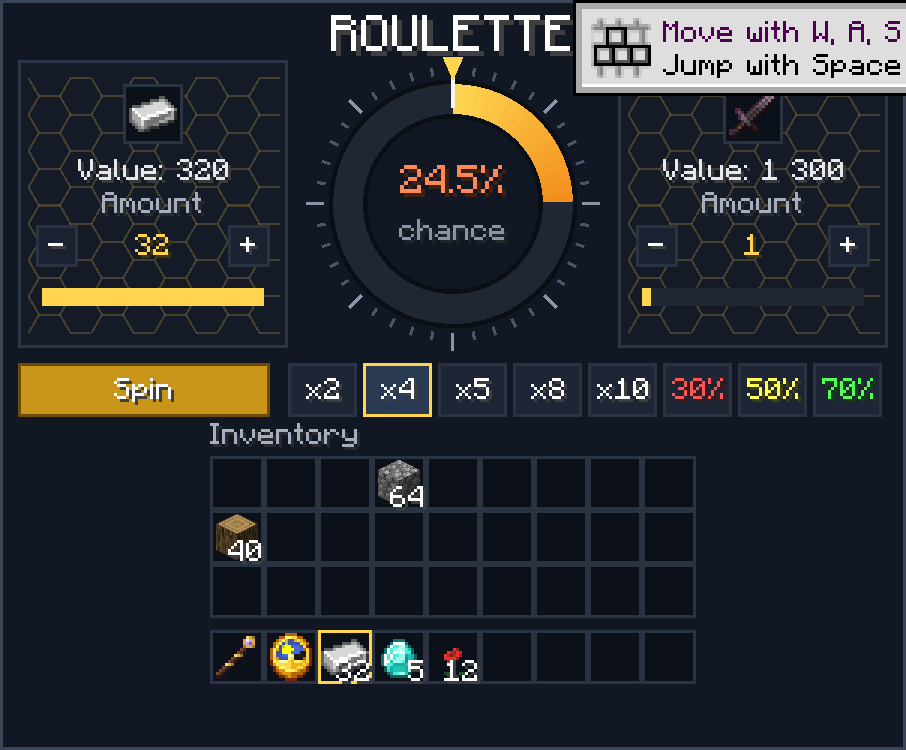
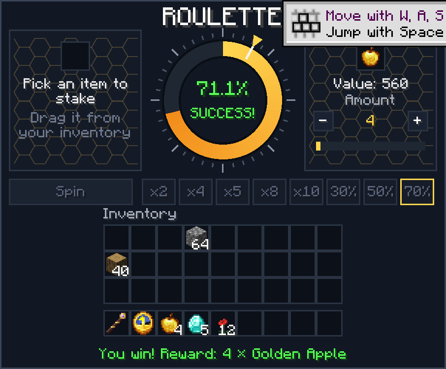

# Kotost Roulette («Рулетка»)

A native mod for [Horizon](https://playhorizon.dev) (Minecraft: Java Edition 26.3 rewritten in Rust).

Stake a stack of ordinary game items, spin a wheel, and win a dearer item or lose the stake. Game items only:
no money, no currency, nothing to buy.

- **Every item has a price in points**: about 400 vanilla items out of the box (a flower 8, an iron ingot 10,
  a diamond 100, a netherite ingot 1000…). Items without a price can't be staked.
- **The stake**: click a stack in your inventory on the roulette screen (right click: one item; the mouse wheel
  over the stake slot changes how many).
- **The reward**, two ways:
  - **x2 / x4 / x5 / x8 / x10**: the item from the table whose points come nearest your stake's points times N;
  - **pick it yourself**: click the reward slot, search the table (by name or id) and pick any dearer item
    (the mouse wheel over the slot changes how many).
- **The chance** is shown before the spin: 0.996 / multiplier (x2: 49.8 %, x4: 24.9 %, x10: 9.96 %).
- **The wheel** turns for 3 seconds: the green sector is your chance, a pointer, slowing down, clicks on the
  sectors, a win and a loss sound.
- **Fair and dupe-proof**: the roll is the server's. It takes the stake the moment it rolls, the client only
  animates the result. Leaving mid-spin changes nothing; a won reward goes into your inventory, onto the ground
  at your feet when it is full, or into your saved inventory when you left.

Every player gets one Roulette item (a clock named «Рулетка» / «Roulette») when they join or respawn without
one; right-click with it to open the wheel. Also `/roulette` (open) and `/roulette give` (one more item).

**Russian and English**: the screen and the messages follow the player's game language (Russian for `ru_*`,
English otherwise).

## Install

You need the Horizon launcher from [playhorizon.dev](https://playhorizon.dev) and a Microsoft account that owns
Minecraft: Java Edition. The mod is needed **on the server and on the client** (single player: just the game).

1. Launcher → **Mods**: find **Kotost Roulette** (once the registry lists it), or **Add from GitHub** and paste
   this repository's URL.
2. The launcher warns that a native mod runs with full access to your computer: read the source first
   (`roulette.rs` and the one-line hooks).
3. It builds the game with the mod (the first build takes 20-40 minutes, later ones a few), then Play.

## Prices

`config/kotost_roulette.txt` in the server's game folder (single player: the game's folder), written with the
defaults the first time. One item per line, `id = points ; Name`:

```
diamond = 100 ; Алмаз
netherite_ingot = 1000 ; Незеритовый слиток
mymod:ruby = 80 ; Рубин
```

Also `edge = 0.996` (the chance of x1), `min_mult = 1.05` (a reward must be at least this much dearer) and
`max_mult = 1000`. The file is read again when it changes: no restart. The client gets the table from the server.

## How it works

`roulette.rs` is put into the game's `game` module (`crate::game::kotost_roulette`). Hooks (`horizon-mixin.toml`):
`register_commands` / `perform_command` (`/roulette`), `use_item` (the item), `net_from_client` (a spin asked
for), `tick` (the server rolls and gives rewards; the client plays the wheel's clicks), and the screen hooks
`net_from_server`, `screen_render_post`, `screen_mouse_button_pressed_pre`, `screen_mouse_scrolled_pre`,
`screen_key_pressed_pre`, `screen_char_typed_pre` (the mod's own screen, `native_mod_screen_open`).

 

Built for Horizon `fdc87ae` (Nightly 2026-11-08); the launcher pins that commit when it builds the mod.

## License

MIT, see [LICENSE](LICENSE). Not affiliated with Mojang, Microsoft or the Horizon project.
